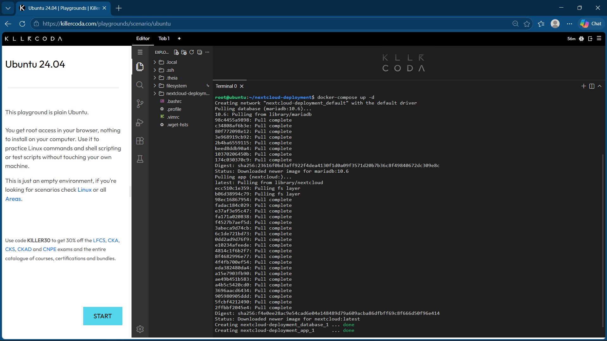
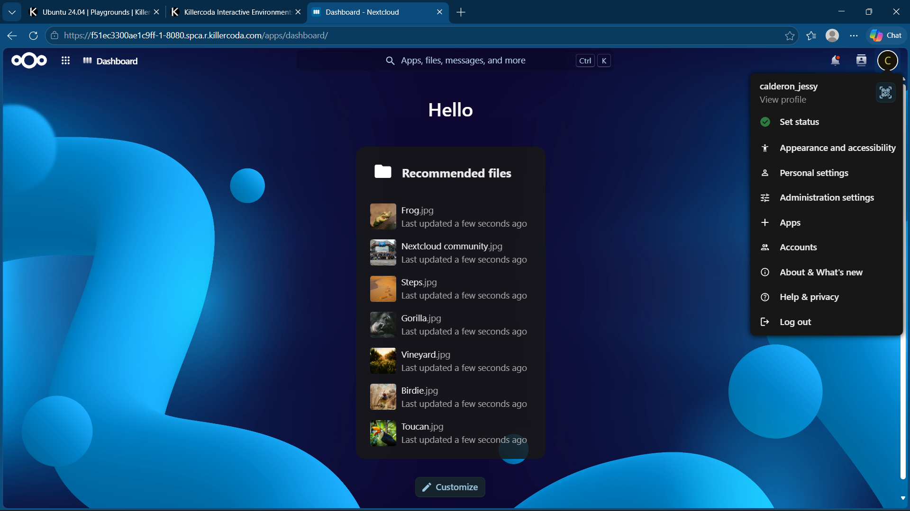
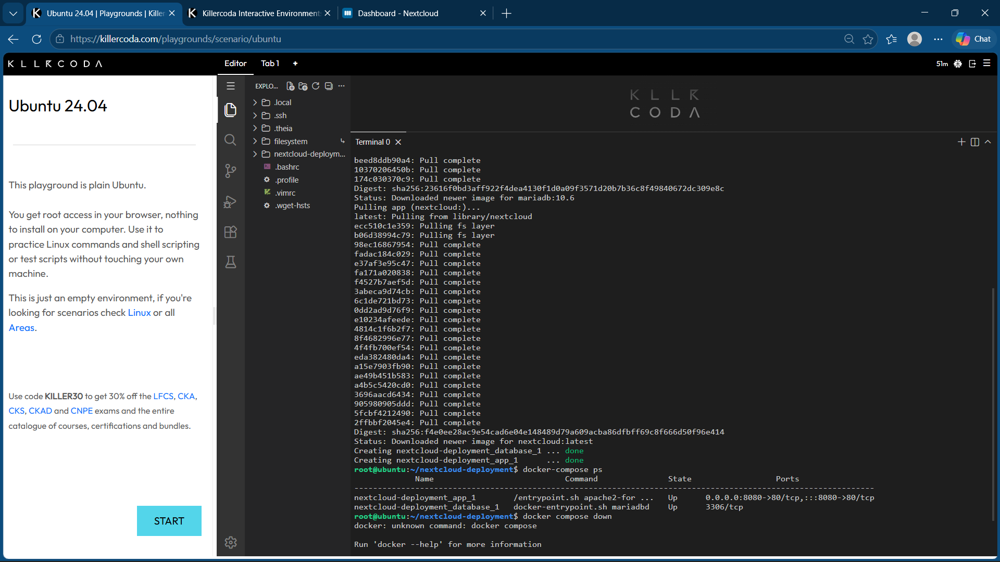

# Mission 6: The Cloud Deployment Engineer

## Mission Overview

This laboratory activity demonstrates how to deploy a private cloud storage application using Docker Compose. The deployment uses Nextcloud as the web application and MariaDB as the database service. Both services are configured in a single YAML file.

## Objectives

- Understand two-tier application architecture.
- Create a Docker Compose configuration file.
- Deploy Nextcloud and MariaDB as separate containers.
- Access the Nextcloud web interface through port 8080.
- Document the deployment process using Markdown.
- Practice Infrastructure as Code (IaC).

## Commands Executed

The following commands were used to create the project directory, configure Docker Compose, deploy the services, check the containers, and stop the deployment.

```bash
mkdir nextcloud-deployment
cd nextcloud-deployment
nano docker-compose.yml
docker-compose up -d
docker-compose ps
docker-compose down
```

## Database Configuration

| Configuration | Value |
|---|---|
| Database service | `database` |
| Database name | `nextcloud_db` |
| Database username | `calderon_jessy` |
| Database server | MariaDB |
| Web application | Nextcloud |
| Port mapping | `8080:80` |

**Note:** The database username and other database credentials must match the environment variables configured in your `docker-compose.yml` file. The example credentials used in a laboratory should not be used in production.

## Two-Tier Architecture

The deployment consists of two main services:

1. **Presentation and application tier:** Nextcloud provides the web interface and cloud storage functionality.
2. **Database tier:** MariaDB stores the application's database information.

Docker Compose manages both containers through one YAML configuration file. The Nextcloud container communicates with the MariaDB container through the Docker Compose service network.


## Screenshots

The following screenshots document the deployment process. Upload the actual image files into the `screenshots` folder in this repository so they can appear below.

### 1. Docker Compose Deployment

This screenshot shows the deployment process and the status of the Nextcloud and MariaDB containers.



**Filename:** `screenshots/compose-deployment.png`

### 2. Nextcloud Web Interface

This screenshot shows the Nextcloud installation page opened through port 8080 in the KillerCoda environment.



**Filename:** `screenshots/nextcloud-web.png`

### 3. Docker Compose Teardown

This screenshot shows the terminal after the Docker Compose services have been stopped and removed.



**Filename:** `screenshots/compose-teardown.png`

## Skills Learned

- Docker Compose configuration
- Multi-container deployment
- YAML syntax and indentation
- Database and web application communication
- Linux command-line operations
- Technical documentation using Markdown
- GitHub portfolio management
- Infrastructure as Code (IaC)

